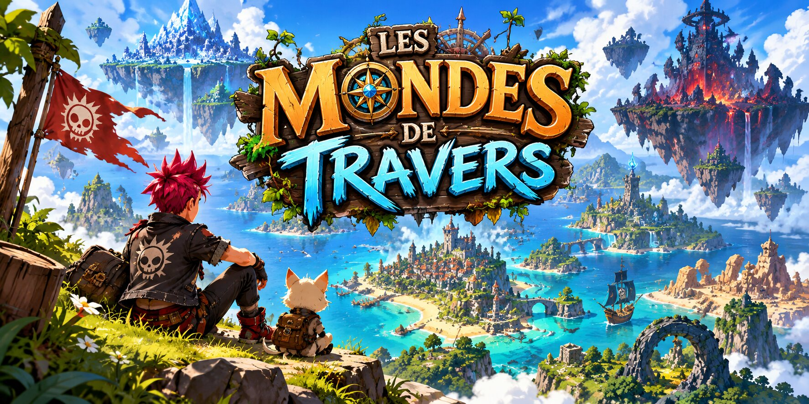

# Les Mondes de Travers

**Un horizon, mille histoires.** Jeu d'aventure fantastique gratuit en monde ouvert, fait avec **Godot 4.7.2** :
un archipel d'îles très différentes (elfes, nains, île flottante, Atlantide, pirates, pyramides, démons, ville
des aventuriers…), des centaines d'habitants, des quêtes, des donjons et des boss. À jouer sur PC ou en VR.

🌐 **Site du jeu : https://janintibo-art.github.io/ile-manga/**

GitHub Actions compile **deux jeux Windows** :

- `Les_Mondes_de_Travers_VR_vN.exe` : Quest 3 via Meta Quest Link ou SteamVR, en OpenXR natif.
- `Les_Mondes_de_Travers_PC_vN.exe` : écran Windows normal, clavier et souris, sans casque.

## Télécharger

- **[Dernière version (Releases)](https://github.com/janintibo-art/ile-manga/releases/latest)** : les deux EXE, une Release par version.
- Ou **Actions > Build Windows EXE VR et PC > dernière exécution verte > Artifacts** (gardés 7 jours).

## Commandes

**PC** : ZQSD (ou WASD / flèches) pour marcher, clic droit maintenu pour tourner la caméra,
Échap ou F9 pour le menu, F5 pour sauvegarder, F11 pour le plein écran, F6 pour la netteté ultra.

**Manette (PC)** : Xbox, PlayStation, Switch Pro… Stick gauche : marcher, stick droit : caméra, A : sauter, B : roulade,
X : frapper, Y : parler / ouvrir, LB : parer, RB : courir, LT : pouvoir, RT : sort, croix : aigle / téléportation / pouvoir / sort,
Start : menu, Select : carnet. Dans les menus : curseur doré (croix ou stick), A pour choisir, B pour revenir.

**VR** : joystick gauche pour marcher, joystick droit pour tourner par crans,
bouton ≡ de la manette gauche pour le menu. Dans le menu : joystick droit pour choisir, gâchette droite pour valider.

## Sauvegardes

Six emplacements plus une sauvegarde automatique toutes les 90 secondes, communs aux deux EXE.
Le menu permet de sauvegarder et de charger une autre partie à tout moment.

## Organisation

- `pcvr/` : le projet Godot (scène, scripts, shaders, préréglages d'export).
- `pcvr/scripts/main.gd` : construction du monde, joueurs, physique, sauvegardes.
- `pcvr/scripts/*_vNN.gd` : chaque série de décors ajoutée par version.
- `www/assets/` : source unique des modèles GLB et des textures, copiés dans Godot par `pcvr/stage_assets.py` au moment de la compilation.
- `.github/workflows/build-pcvr-native.yml` : contrôles et export des deux EXE (artefacts + Release).
- `site/` et `.github/workflows/deploy-pages.yml` : le site web du jeu (GitHub Pages).

## Nouvelle version

Le numéro de version se change **à un seul endroit** : `config/name` dans `pcvr/project.godot`
(par exemple `"Les Mondes de Travers VR V73"`). Le workflow en déduit le nom des EXE, des artefacts,
de la Release et les numéros de version Windows.

Guide détaillé (Quest Link, SteamVR, dépannage) : [docs/PC_VR_NATIVE.md](docs/PC_VR_NATIVE.md).
